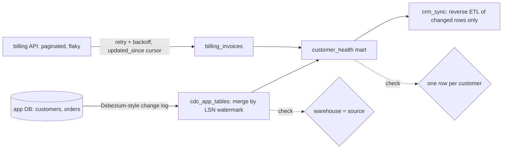

# Ingestion & Orchestration

[](https://github.com/Saigwe/ingestion-orchestration/actions/workflows/ci.yml)
 

> **Headline:** customer health reaches the CRM **every hour instead of overnight**. Updates and deletions are captured as they happen, API outages are retried automatically, and only changed accounts are synced.

An end-to-end pipeline of the kind analytics engineers and data engineers own: capture changes from an application database, extract from a flaky paginated API, model a customer health score, and push it back into the CRM. It's orchestrated with **Dagster** assets, data checks and an hourly schedule.



## What it demonstrates

| Pattern | Implementation |
|---|---|
| **Change data capture** | Reads a Debezium-style log (`lsn`, op `c`/`u`/`d`, row after the change) past a stored watermark and merges inserts, updates and **deletes** into DuckDB inside a transaction |
| **Idempotency** | Re-running with no new source changes applies 0 events and sends 0 CRM updates (tested) |
| **Resilient API extraction** | Cursor pagination, an `updated_since` high-water mark, and exponential backoff on simulated 503s |
| **Modelling** | `customer_health`: orders, revenue, unpaid invoices and an `at_risk` / `healthy` / `new` score |
| **Reverse ETL** | Diffs against the last synced snapshot and writes only changed accounts (plus deletions) to a CRM outbox in Salesforce-style upsert format |
| **Orchestration** | Dagster software-defined assets, asset checks (source reconciliation, uniqueness), run metadata and an hourly `ScheduleDefinition` |

The run report is [`output/pipeline_report.md`](output/pipeline_report.md): six simulated hours of activity, per-run CDC counts, API retries, CRM sync volumes and check results.

## Run it

```bash
pip install -r requirements.txt
python -m pipeline.run                      # simulate 6 hours, materialise after each, write the report
dagster dev -m pipeline.definitions         # optional: browse the asset graph, checks and schedule in the UI
pytest
```

The simulator stands in for Postgres + Debezium + a SaaS billing API so everything runs locally. In production, the same assets would read from Kafka Connect / Debezium topics and the real API, and `crm_sync` would call the CRM's bulk API.

## Stack

Dagster, DuckDB, SQLite (source stand-in), Python, pytest.
